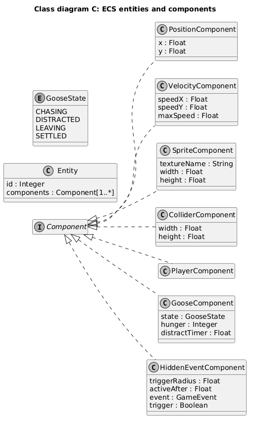
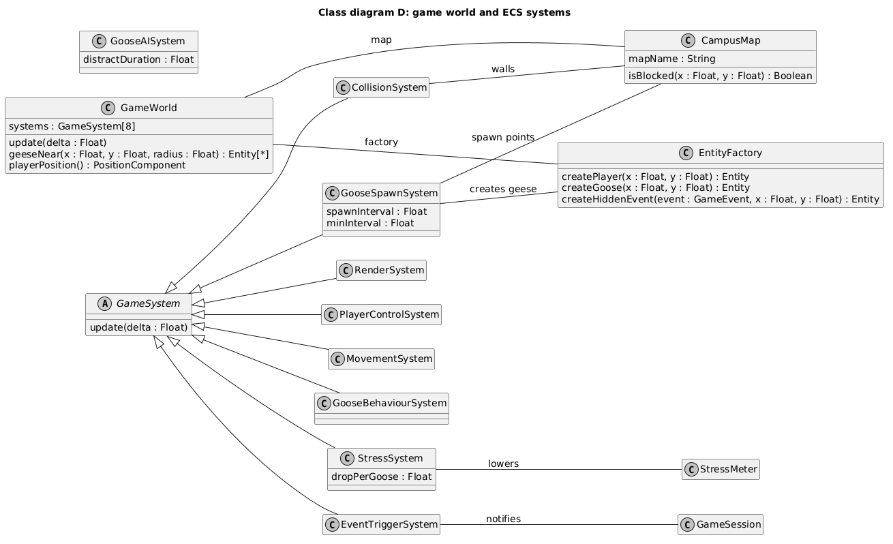

How our architecture changed over the project. The final version is described in Arch1.

## Version 1 (25 October)
From the CRC cards: Player and Goose inherit from Entity, and GameScreen owns almost everything.

## Version 2 (1 November)
Moved to ECS, moved the rules into GameSession, and added the Listener, Factory and Façade patterns.

## Version 3: implementation (16 November)
Own ECS instead of Ashley, stress bar fills up, GameViewport, Long Boi replaces ProtectiveGeese.

The component diagram, class diagrams A and B, the state machine and the Bread Van sequence diagram are in the main Arch1 document. The diagrams below are extra detail that did not fit there.

